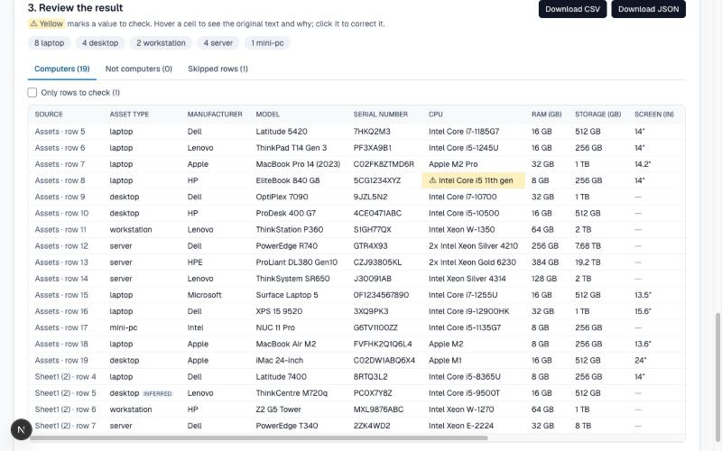

# Asset Sheet Extractor

Upload an IT asset spreadsheet in any layout and get a clean table of assets: type, manufacturer,
model, serial number, CPU, RAM, storage and screen size, each with a confidence level and the
original text beside it.

No two asset registers look alike. Headers start on row 4, RAM is spelt three ways, a whole
laptop is typed into one cell, and there is a second tab nobody dares delete. This app is built
for the file it has not seen yet: it never assumes a layout, it shows what it is unsure about,
and it lets the user correct it in one click.



## Run it

Requires Node.js 20.9 or later and pnpm.

```bash
pnpm i && pnpm dev
```

Open http://localhost:3000 and drop a spreadsheet, or click one of the six bundled samples.

```bash
pnpm test        # 287 unit and pipeline tests
pnpm typecheck
pnpm lint
pnpm build
```

The app works fully without any API key. To try the optional AI suggestion, copy `.env.example`
to `.env.local` and set `ANTHROPIC_API_KEY`.

## What it does

1. **Reads** `.xlsx`, `.xls`, `.csv` and `.tsv` in the browser. The file is never uploaded.
2. **Finds the header row** wherever it is, or works without one.
3. **Maps each column** to a field from its name and from its values, with a confidence level and
   a reason in plain words.
4. **Splits combined cells** such as `HP EliteBook 850 G7 - i7-10610U / 16GB / 512GB SSD / 15.6in`.
5. **Normalises values**: `32768 MB` → 32 GB, `4 x 1.92TB SSD (RAID 5)` → 7,680 GB,
   `Intel i7-10700` → `Intel Core i7-10700`, `12/03/2021` → `2021-03-12`.
6. **Sets aside what is not a computer** (monitors, keyboards, switches) and **explains every row
   it skipped** (totals, repeated headers, notes).
7. **Lets the user fix it**: change the header row, remap a column, edit a cell, move a row
   between "computer" and "not a computer". Results update immediately.
8. **Exports** clean CSV and JSON, checked against a Zod schema.

## How it works

Everything that interprets data is a pure function in `src/lib/extraction`. The same code runs in
the browser and in the tests, and a mapping change is applied by calling the pipeline again.

```
file ─► readWorkbook ─► detectHeader ─► mapColumns ─► extractAssets ─► exportAssets
        bytes to        which row       column to     row to asset     CSV / JSON
        text cells      has the names   field         │
                                                       ├─ normalise      one cell, one value
                                                       └─ parseFreeText  one cell, several values

optional, on a click:  unclear columns ─► POST /api/suggest-mapping ─► Claude ─► suggestions
```

| Stage | File | What it decides, and how |
| --- | --- | --- |
| Read | `readWorkbook.ts` | The only code that knows SheetJS. Detects the format from the first bytes, not the extension. Text files are decoded by us and read as raw text, so `0012345` and `12/03/2021` stay as typed. Date cells are converted from their day number, so no time zone is involved. |
| Header | `detectHeader.ts` | Scores the first 30 rows: +3 for a known column name, +1 for a label, −2 for data. A header must have a table of similar width under it, so titles and footers lose. |
| Columns | `mapColumns.ts`, `fields.ts` | Header evidence (known name, name inside a longer header, abbreviation, misspelling) combined with value evidence (what the cells look like). Values can weaken a header match or map a column with no header. |
| Values | `normalise.ts` | One normaliser per field. Each returns a value, a confidence and a note, and returns nothing rather than guess. |
| Combined cells | `parseFreeText.ts`, `vocab.ts` | Recognises the parts with a known shape (CPU, screen, capacities), cuts them out, and reads the rest as brand and model. RAM and storage are told apart by label, then unit, then position, and by size only as a last resort. |
| Rows | `extractAssets.ts` | A value from its own column beats one dug out of a description. Summary rows, repeated headers and rows with no asset details are skipped with a reason. Duplicate serial numbers are flagged across sheets. |
| Export | `exportAssets.ts` | Every row is parsed against a Zod schema. CSV cells that would run as a formula are neutralised. |

### Confidence

Every column mapping and every value carries a number from 0 to 1, shown as a level:
**High** (0.85 and above), **Medium**, or **Check** (below 0.7, highlighted yellow). The level
always comes with its reason, for example:

- `"S/N" is a known name for Serial number` → High
- `"Mdl" looks like an abbreviation of "model"` → Medium
- `4 of 4 values look like Serial number` → Check, because any identifier looks like a serial
- `Only one size in the cell and no label; small, so taken as RAM` → Check

A value's confidence is its own confidence times that of the column it came from. A value that is
not written in the file but follows from it (ThinkPad → Lenovo, laptop) is marked "inferred".

## Results on real files

These numbers are asserted by `src/lib/extraction/pipeline.test.ts`, not measured by hand.

| File | What makes it hard | Result |
| --- | --- | --- |
| `sample_assets_1.xlsx` (client) | Title rows, header on row 4, `TOTAL` row, second sheet with a `CPU / RAM / Disk` column | Headers found on rows 4 and 3; 15 + 4 = 19 assets; `TOTAL` skipped with a reason |
| `sample_assets_2.csv` (client) | Everything in `Item Description`; monitor and keyboard mixed in; two date formats | 14 of 14 computers with all six fields right; 2 non-computers set aside; NAS typed as `nas` |
| `vn_headers_row7.xlsx` | Vietnamese headers on row 7, blank rows, real date cells, bare numbers under `Bộ nhớ (GB)`, hidden sheet | 5 computers, 1 monitor, total row skipped, dates correct, duplicate serial flagged across sheets |
| `semicolon_abbrev.csv` | `;` delimiter, BOM, title line with commas, headers `Mfr;Mdl;SN;Proc;Mem;Stor;Scr`, decimal commas | All 9 columns mapped; 5 assets |
| `no_header.tsv` | No header row at all | Columns identified from values; the serial column is flagged because nothing names it |
| `one_cell_per_asset.xls` | One free-text cell per asset, old `.xls` format, includes `Dell Lat 5420 i7 16GB` from the brief | 5 computers, a monitor and a switch set aside, a note skipped |

The last four are generated by `pnpm fixtures` (`scripts/make-fixtures.mjs`), so what each file
contains is written down and reviewable.

## Decisions and trade-offs

The full reasoning is in [`.local-map/DECISIONS.md`](.local-map/DECISIONS.md); research with
sources is in [`docs/research.md`](docs/research.md).

| Decision | Why | What it costs |
| --- | --- | --- |
| Parse in the browser | The client's business is data sanitisation: an asset list should not leave the device to be read. Also avoids Vercel's 4.5 MB request limit, and remapping is instant. | The parser ships to the browser (128 KB gzip, loaded only when a file is opened). No server-side check of the file. |
| Rules first, LLM last and opt-in | Rules are free, instant, offline, repeatable and unit-testable. An LLM is right exactly where rules run out: a column name nobody anticipated. | More code than one prompt. Unusual wording inside cells is not rescued by AI; it shows as "Check" and can be edited. |
| SheetJS from its own CDN | `xlsx` on npm is frozen at 0.18.5 with two published CVEs; `exceljs` has four unfixed ones. 0.20.3 from `cdn.sheetjs.com` reads xlsx, xls and csv with one code path. | A dependency that is not on npm, and has had no release since 2024. It sits behind one function so it can be swapped. |
| Hand-written rules for combined cells | No maintained library parses hardware strings. Rules never invent a value. | Phrasings the rules do not know are missed. |
| Storage decimal, RAM binary | That is how each is sold: 1 TB = 1000 GB, 16384 MB = 16 GB. | `512GB + 1TB` reads as 1512 GB, not what an OS reports. |
| CPU names canonicalised | `i5-8365U` → `Intel Core i5-8365U` makes the table consistent. The prefix comes from a table, not a guess. | The value shown is not verbatim; the original is kept and shown on hover. |
| Plain Tailwind, native controls | One drop zone, a few selects, one table. No generated component code to explain. | Less polish than a component library. |
| Unit and fixture tests, no browser test | The risk is in interpreting data, which is all pure functions. | A broken button would not be caught by the test suite; the UI was checked by hand in a browser. |

## Security and privacy

- The spreadsheet is parsed in the browser tab. There is no upload endpoint and nothing is stored.
- Limits: 5 MB per file, 5,000 rows and 60 columns per sheet, 20 sheets. Files that are empty, not
  spreadsheets, corrupt or encrypted are refused, each with its own message.
- The only request that carries data is the optional AI suggestion, sent after an explicit click.
  It contains the column names of one sheet and up to five sample values from the unclear columns
  only. Identifiers are masked to their shape (`7HKQ2M3` → `9AAA9A9`). The UI states this before
  the click.
- The API key is read on the server and never reaches the browser. The model's answer is treated
  as untrusted: validated against a schema, applied only to unclear columns, never allowed to
  take a field from a settled column, capped at "Medium" and labelled "AI".
- Exported CSV neutralises cells that would run as formulas in Excel.
- No secrets in the repository: `.env.local` is ignored; `.env.example` documents the variables.

## Known limitations

- **One table per sheet.** Two tables stacked in one sheet, or a table laid out sideways (fields
  down, assets across), are not handled. The user can pick the header row, but not a second one.
- **One row is one asset.** A quantity column above 1 raises a warning; the row is not multiplied.
- **Vocabulary is finite.** Brands, product lines and CPU families come from tables in
  `vocab.ts`. An unknown brand is kept as written; an unknown line gives no inferred type.
- **Network and storage gear.** A switch described without the word "switch" is listed as a
  computer of unknown type.
- **RAID.** Storage is raw capacity (drives × size); RAID level is ignored.
- **Dates.** Ambiguous dates are read day-first (Australia) and flagged, not resolved.
- **The AI route is unauthenticated** and not rate-limited. Request size and answer length are
  capped, but before real use it needs authentication and a rate limit.
- **The AI route was not exercised against a live model.** It is covered by tests with a fake
  client and was run in the browser with an invalid key (the 401 path). A valid key is needed to
  confirm real suggestions.
- **A password-protected workbook** is reported from SheetJS's error message; no such file was
  available to test with.
- **Large sheets** are parsed on the main thread. At the 5,000-row limit planning and extraction
  take about 0.3 s; a Web Worker would be the next step beyond that.
- **Light theme only**, and the UI was checked in Chromium only.

## How AI was used

**To build it.** The repository was written with Claude Code (Anthropic), working as an agent
under a written brief. I wrote the brief and its acceptance criteria; the agent tightened it into
[`docs/spec.md`](docs/spec.md), researched the open questions with sources, planned, and then
wrote tests before code for each stage of the pipeline.

What kept the agent's work checkable:

- **Acceptance criteria as tests.** "19 assets", "14 of 14 computers" and the rest are assertions
  on the real sample files in `pipeline.test.ts`. A stage was done when its tests passed, not
  when the agent said so.
- **Rules it had to follow**, in [`AGENTS.md`](AGENTS.md): never invent data, rules before LLM,
  test first, keep the pipeline pure, no dependency without a recorded decision.
- **A map of the work**, in [`.local-map/`](.local-map/README.md): what was done in what order
  with evidence (`JOURNEY.md`), each decision with its cost (`DECISIONS.md`), where everything is
  (`MAP.md`), screenshots, and the scripts used to inspect the sample files.
- **A review pass as the client's engineer**, which found and fixed four data bugs after the
  tests were green. They are listed in [`.local-map/REVIEW.md`](.local-map/REVIEW.md).

**Inside the app.** One optional LLM call, off unless a key is configured and the user clicks:

| What | Where |
| --- | --- |
| Prompt | `src/lib/llm/prompt.ts` |
| Request and answer schemas | `src/lib/llm/schema.ts` |
| What is sent, and how the answer is applied | `src/lib/llm/suggestions.ts` |
| Server route (Claude API, structured output) | `src/app/api/suggest-mapping/route.ts` |

It is asked one narrow question: for the columns the rules could not identify, which field does
each hold? It never sees a whole spreadsheet and never produces asset data. The default model is
`claude-opus-5-5`; set `ANTHROPIC_MODEL=claude-haiku-5-5` for a cheaper one.

## Five-minute demo

1. **The problem (30 s).** Open `public/samples/sample_assets_1.xlsx` in a spreadsheet app: title
   rows, header on row 4, a `TOTAL` row, a second sheet called `Sheet1 (2)`.
2. **The happy path (60 s).** Click *Client sample 1*. Point at: header found on row 4 with its
   reason; ten columns mapped with a reason each; 19 assets from two sheets; `32768 MB` shown as
   32 GB with the original on hover; the one yellow cell (`Core i5 11th gen`, no model number);
   *Skipped rows (1)* explaining the `TOTAL` row.
3. **Combined cells (60 s).** Click *Client sample 2*. One description column becomes six fields;
   types are marked "inferred"; open *Not computers (2)* for the monitor and the keyboard.
4. **A file it has never seen (90 s).** Upload the client's own test file. If something is wrong,
   fix it live: change the header row, remap a column, edit a cell. If no file is offered, click
   *No header row* and *Abbreviated headers*.
5. **When things go wrong (30 s).** Drop a PDF or an image: a specific message and a next step.
6. **Take it away (30 s).** *Download CSV*, open it, show the `confidence` and `needsReview`
   columns.

Three points to make:

1. **It is honest about doubt.** Unknown stays empty; uncertain is yellow with a reason; inferred
   is labelled. A wrong value shown confidently is the failure this tool exists to prevent.
2. **Rules first, AI last.** The pipeline is deterministic and has 287 tests; the LLM is a small,
   opt-in second opinion that is not trusted. That is a choice about privacy and repeatability,
   not about cost.
3. **Built to be changed.** Teaching it a new column name or product line is one row in a table
   plus one test. The parser library sits behind one function.

## Deploying

The app is a standard Next.js project and deploys to Vercel without configuration. Set
`ANTHROPIC_API_KEY` in the project's environment variables only if the AI suggestion is wanted;
the "Ask AI" button appears when the key is present at build time.

## Repository layout

```
src/lib/extraction/   the pipeline (pure TypeScript) and its tests
src/lib/llm/          prompt, schemas and request building for the optional AI suggestion
src/components/       the four panels of the page
src/app/              page, layout, and the one API route
public/samples/       the client's two samples and four generated fixtures
scripts/              fixture generator
docs/                 spec, research summary, plan
.local-map/           map of the project: journey, decisions, review, screenshots, evidence
.agent/, .claude/     how coding agents share the work: protocol, handoff, skills, subagents
AGENTS.md             rules and commands for any coding agent
```
